# AI 수학 기초: 선형대수 · 미적분 · 최적화 · 확률

AI 모델이 데이터를 처리하고 학습하는 과정의 수학(행렬 변환, 고유값·SVD, 수치 미분, 역전파, 경사하강법, 손실 함수와 최대우도추정)을 **NumPy로 직접 구현하고 Matplotlib/Seaborn으로 시각화**했습니다. 딥러닝 프레임워크(PyTorch·TensorFlow·JAX)와 scikit-learn은 쓰지 않았습니다.

> **핵심 결과**
> - 행렬식 det(A)와 변환 후 넓이 비율이 행렬 5개 모두 **오차 1e-13% 이하**로 일치합니다 (기준 1%).
> - 직접 만든 Power Iteration의 최대 고유값이 `np.linalg.eig`와 행렬 4개 모두 **오차 2e-7% 이하**로 일치합니다 (기준 5%).
> - 2층 신경망 역전파를 손으로 유도한 기울기가 NumPy 계산(소수점 4자리 13개 항목)과 **수치 미분(상대 오차 2.0e-11)** 모두와 일치합니다.
> - 경사하강법은 f = x² + y²에서 lr = 0.1, 100회 후 원점까지 **1.4e-9**에 도착합니다. 발산 경계는 lr = 1이고, Momentum은 길쭉한 그릇 x² + 10y²에서 lr을 작게 잡을 때 빠릅니다(lr = 0.01: GD 194회 vs Momentum 77회).
> - MSE는 정규분포, Cross-Entropy는 베르누이/카테고리분포를 가정한 최대우도추정(MLE)과 같다는 것을 유도하고 숫자로 확인했습니다.
> - 검증: `run_all.py` **27/27**, 역전파 노트북 **6/6**, 확률 노트북 **12/12** 통과.

## 목차

1. [폴더 구조](#1-폴더-구조)
2. [실행 방법](#2-실행-방법)
3. [단계별 내용과 주요 결과](#3-단계별-내용과-주요-결과)
4. [과제 예시·안내와 다르게 처리한 곳](#4-과제-예시안내와-다르게-처리한-곳)
5. [자동 검증 목록](#5-자동-검증-목록)
6. [이미지 출처](#6-이미지-출처)
7. [과제 요구사항 대응표](#7-과제-요구사항-대응표)

---

## 1. 폴더 구조

```
ai-math-foundations/
├─ README.md
├─ requirements.txt                 라이브러리와 버전
├─ run_all.py                       src 모듈을 실행해 그림 16장 저장 + 검증 27개 출력 ([통과]/[실패])
├─ src/
│  ├─ linear_algebra.py             행렬 변환·행렬식, Power Iteration, SVD 이미지 압축
│  ├─ calculus.py                   수치 미분(중심차분), Gradient, 등고선 그림
│  ├─ optimizer.py                  VanillaGD · Momentum 클래스, 경로 기록, 경로 그림
│  └─ plot_utils.py                 한글 폰트 설정, outputs/ 저장 (공통)
├─ notebooks/
│  ├─ backprop_derivation.ipynb     2층 신경망 역전파 유도 · 손계산 · NumPy · gradient check (그림 1장)
│  └─ probability_loss.ipynb        정규·베르누이 분포, softmax, MSE·CE = MLE 유도 (그림 3장)
└─ outputs/                         모든 그림 PNG (20장)
```

## 2. 실행 방법

**환경**: Python **3.12 이상** (고정한 `numpy==2.5.5`가 3.12 이상을 요구합니다). Windows 10 + Python 3.14.3에서 검증했습니다.

### 2-1. 저장소 받기와 설치

```bash
git clone https://github.com/byungwoo2026/ai-math-foundations_A2-1.git
cd ai-math-foundations_A2-1
python -m venv .venv
# Windows PowerShell:  .venv\Scripts\Activate.ps1
# macOS / Linux:       source .venv/bin/activate
pip install -r requirements.txt          # 약 4분 (처음 설치할 때)
```

### 2-2. 모듈 실행과 검증 (`src/`)

```bash
python run_all.py                        # 약 30초
```

`outputs/`에 그림 16장을 저장하고, 항목마다 `[통과]`/`[실패]`와 근거 숫자를 출력합니다. 마지막 줄이 `전체: 27/27 통과`이면 정상이고, 하나라도 실패하면 종료 코드 1로 끝납니다.

### 2-3. 노트북 실행 (`notebooks/`)

노트북 두 개는 **실행 결과(출력·그림)가 저장된 상태**로 올라가 있어서 GitHub에서 바로 볼 수 있습니다. 직접 다시 실행하려면:

- VS Code / Jupyter에서 노트북을 열고 커널로 `.venv`의 Python을 고른 뒤 "모두 실행"
- 또는 터미널에서 (원본은 그대로 두고 실행 사본을 `results/`에 저장합니다):

```bash
jupyter nbconvert --to notebook --execute notebooks/backprop_derivation.ipynb --output-dir results
jupyter nbconvert --to notebook --execute notebooks/probability_loss.ipynb --output-dir results
```

각각 약 20초 걸립니다. 노트북 마지막 칸에 `전체: 6/6 통과`, `전체: 12/12 통과`가 나오면 정상입니다. 노트북도 `outputs/`에 그림을 저장합니다.

> **재현 확인**: GitHub에서 새 폴더로 받아 위 순서 그대로 설치·실행했을 때, `run_all.py` 출력 76줄과 노트북 두 개의 출력이 원래 결과와 같았고, 다시 그린 그림 20장도 저장소의 그림과 바이트 단위로 같았습니다(시드 42 고정).

> 그림의 한글은 설치된 한글 폰트(Windows: 맑은 고딕, macOS: AppleGothic, Linux: 나눔고딕 등)를 자동으로 찾아 씁니다. 한글 폰트가 없으면 글자가 네모로 보일 수 있지만 계산 결과에는 영향이 없습니다.

## 3. 단계별 내용과 주요 결과

### 3-1. 행렬 변환과 행렬식 (`src/linear_algebra.py`)

단위 원(점 100개)에 회전 R(30°), 스케일링 S(2, 0.5), 전단 Sh(1)을 적용해 전후를 겹쳐 그렸습니다. 행렬의 **열은 기준 벡터 e₁, e₂가 도착하는 곳**이라서, 그림에 두 화살표의 이동도 함께 표시했습니다.

| 행렬 | det | 넓이 비율 (신발끈 공식) | 오차 |
|---|---|---|---|
| 회전 R(30°) | 1 | 1.0000 | 1.1e-14% |
| 스케일링 S(2, 0.5) | 1 | 1.0000 | 0 |
| 전단 Sh(1) | 1 | 1.0000 | 1.1e-14% |
| 일반 [[4, 1], [1, 3]] | 11 | 11.0000 | 3.2e-14% |
| 뒤집기 [[1, 0], [0, −1]] | −1 | −1.0000 (방향이 뒤집힘) | 0 |

과제의 세 변환은 모두 det = 1이라, "det = 넓이 배율"을 확실히 보이려고 det ≠ 1인 행렬 두 개를 더 넣었습니다. 넓이는 변환 전후 다각형(99각형)을 같은 방식(신발끈 공식)으로 재서 비교했습니다. 원의 넓이 π를 기준으로 하면 다각형 근사 때문에 0.067%의 차이가 생깁니다.

| 회전 | 스케일링 | 전단 |
|---|---|---|
| 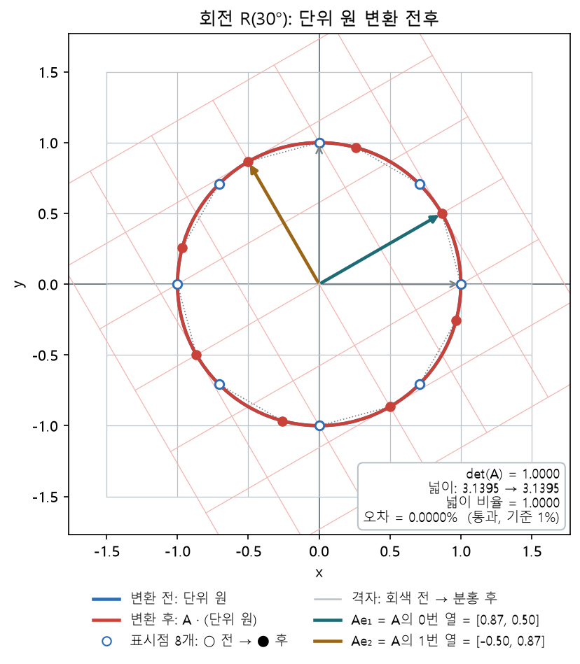 | 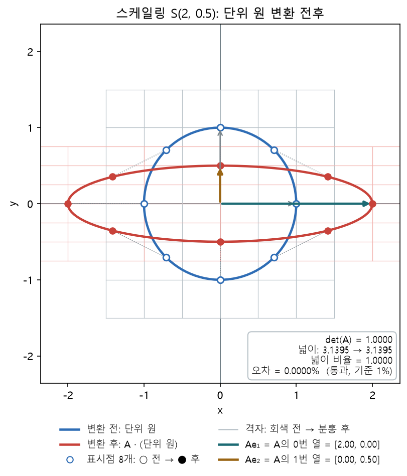 | 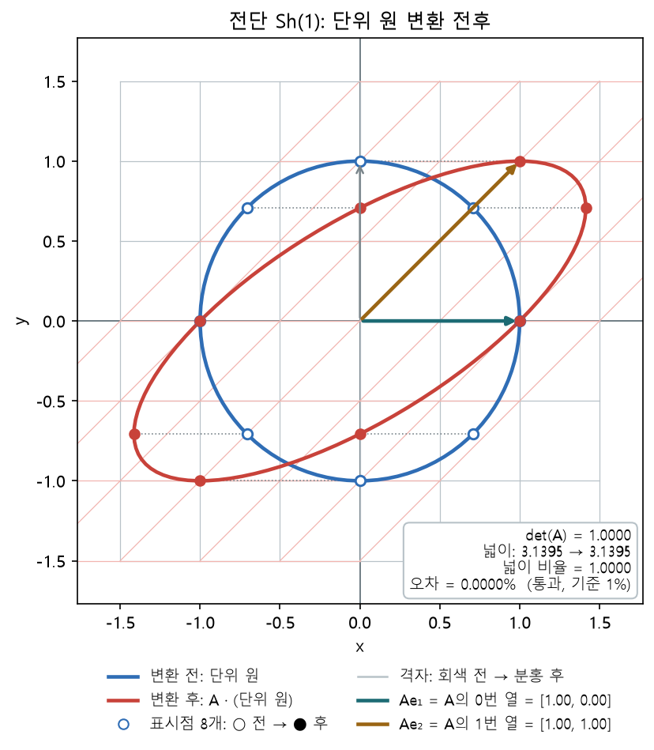 |

### 3-2. Power Iteration으로 최대 고유값 (`src/linear_algebra.py`)

v ← Av / ‖Av‖를 반복해 **벡터 방향의 변화가 1e-6보다 작아지면** 멈춥니다. (고유값 λ의 변화로 멈추면 [[4, 1], [1, 3]]에서 12회에 멈추고 벡터의 4번째 자리가 틀려서, 벡터 기준을 썼습니다.) `np.linalg.eig`는 비교용 검증 함수에서만 썼습니다.

| 행렬 | 반복 | Power Iteration λ | `np.linalg.eig` λ | 오차 |
|---|---|---|---|---|
| [[4, 1], [1, 3]] (과제 예시) | 21회 | 4.6180, v = [0.8507, 0.5257] | 4.6180 | 4.8e-11% |
| 3×3 [[2, −1, 0], [−1, 2, −1], [0, −1, 2]] | 26회 | 3.4142 | 3.4142 | 3.5e-11% |
| [[1, 2], [3, 4]] (비대칭) | 7회 | 5.3723 | 5.3723 | 1.6e-7% |
| 5×5 무작위 대칭 (최대가 음수) | 32회 | −3.2896 | −3.2896 | 7.7e-12% |

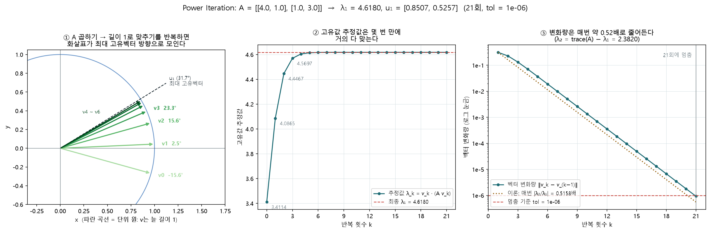

### 3-3. SVD 이미지 압축 (`src/linear_algebra.py`)

128×128 흑백 사진을 SVD로 분해하고 앞 k개 성분만으로 복원했습니다. 저장할 숫자는 k × (128 + 128 + 1)개입니다.

| k | 저장할 숫자 (원본 16,384 대비) | 복원 오차 | 에너지 (σ² 비율) |
|---|---|---|---|
| 10 | 2,570개 (15.7%) | 21.06% | 95.56% |
| 50 | 12,850개 (78.4%) | 4.54% | 99.79% |
| 100 | 25,700개 (**156.9%**) | 0.43% | 99.998% |

k = 100은 원본보다 숫자가 많아서 압축이 아닙니다 (손익분기 k = 16,384 / 257 ≈ 63.75). 복원 오차가 "버린 특이값 제곱합의 비율의 제곱근"(Eckart–Young)과 일치하는 것, 최대 특이값 σ₁ = 46.045가 Power Iteration(AᵀA)으로 구한 값과 같은 것도 확인했습니다.

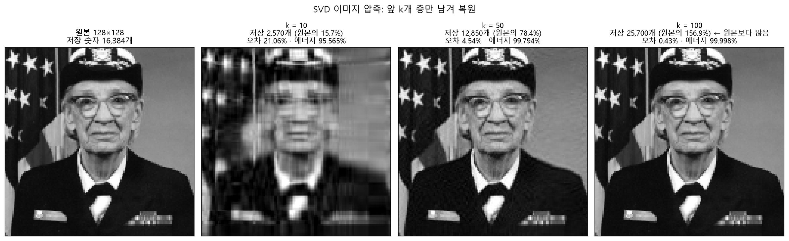

### 3-4. 수치 미분과 Gradient (`src/calculus.py`)

중심차분 f′(x) ≈ (f(x + h) − f(x − h)) / 2h (h = 1e-5)로 f(x) = x²의 x = 3 미분값을 구하면 **6.000000000039**입니다 (오차 3.9e-11). 전방차분은 오차가 h에 비례하고 중심차분은 h²에 비례하며, h를 1e-12처럼 너무 작게 하면 반올림 오차로 오히려 기준(1e-4)을 넘는 것도 그림으로 확인했습니다.

f(x, y) = x² + y² 등고선 위 18개 점에서 Gradient 화살표를 그렸고, **Gradient 공식을 쓰지 않고 직접 찾은 등고선 접선**과의 각도가 모두 90.0000°(최대 차이 4.0e-10°)였습니다.

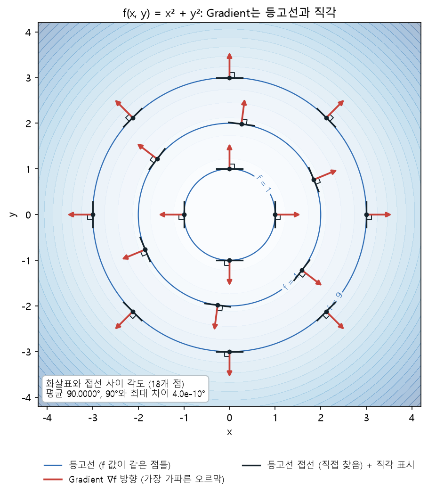

### 3-5. 역전파 수식 유도 (`notebooks/backprop_derivation.ipynb`)

2층 신경망(2 → 2 → 1, sigmoid, BCE)에서 순전파 수식과 shape을 쓰고, 연쇄 법칙으로 출력층 → 입력층 순서로 기울기를 유도했습니다. 고정 예제: x = [1, 0], W1 = [[0.1, 0.2], [0.3, 0.4]], b1 = 0, W2 = [0.5, 0.6], b2 = 0, y_true = 1.

| 값 | 공식 | shape | 결과 (4자리) |
|---|---|---|---|
| z1, a1 | W1 @ x + b1, σ(z1) | (2,) | [0.1, 0.3], [0.5250, 0.5744] |
| z2, ŷ, L | W2 · a1 + b2, σ(z2), BCE | () | 0.6072, 0.6473, 0.4350 |
| ∂L/∂ŷ | −y/ŷ + (1 − y)/(1 − ŷ) | () | −1.5449 |
| ∂L/∂z2 | ∂L/∂ŷ × ŷ(1 − ŷ) = **ŷ − y** | () | −0.3527 |
| ∂L/∂W2 | ∂L/∂z2 · a1 | (2,) | [−0.1852, −0.2026] |
| ∂L/∂a1 | ∂L/∂z2 · W2 | (2,) | [−0.1764, −0.2116] |
| ∂L/∂z1 | ∂L/∂a1 ⊙ a1(1 − a1) | (2,) | [−0.0440, −0.0517] |
| ∂L/∂W1 | outer(∂L/∂z1, x) | (2, 2) | [[−0.0440, 0], [−0.0517, 0]] |

손계산과 NumPy가 13개 항목 모두 소수점 4자리까지 일치했고, 공식을 쓰지 않는 수치 미분(Step 4의 `numerical_gradient`)과도 상대 오차 2.0e-11로 일치했습니다(gradient check). 구한 기울기로 한 걸음(lr = 0.5) 학습하면 손실이 0.4350 → 0.3395로 줄어듭니다. 추가로 sigmoid 출력에 MSE를 쓰면 확신하며 틀린 경우 기울기가 거의 0이 되는 것(z2 = −5에서 BCE −0.993 vs MSE −0.013)을 그림으로 비교했습니다.

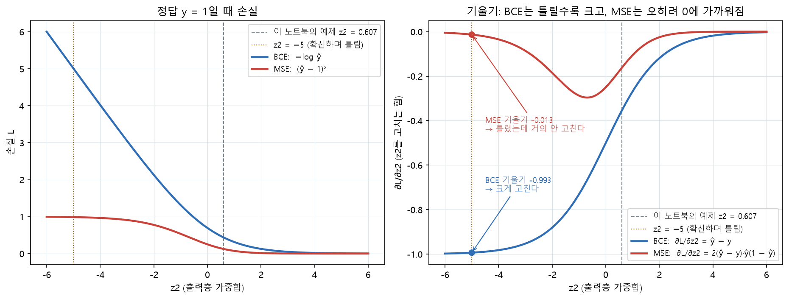

### 3-6. 경사하강법과 Momentum (`src/optimizer.py`)

`VanillaGD`(x ← x − lr·∇f)와 `Momentum`(v ← β·v + ∇f, x ← x − lr·v, β = 0.9)을 한 걸음(`step`)만 맡는 클래스로 만들고, `run_optimizer`가 반복하며 경로를 기록합니다. 출발점은 (5, 5)입니다.

- **과제 기준**: f = x² + y², lr = 0.1, 100회 후 위치 (1.0e-9, 1.0e-9), 원점까지 1.4e-9 (반경 0.1 이내). 한 걸음이 위치에 (1 − 2·lr) = 0.8을 곱하는 것과 같습니다.
- **발산**: 배율 |1 − 2·lr|이 1을 넘으면 발산 → x² + y²의 경계는 **lr = 1** (lr = 1.1이면 100회 후 5.9e8). x² + 10y²는 y 방향 배율이 (1 − 20·lr)이라 경계가 **lr = 0.1**로 내려갑니다.
- **Momentum**: 둥근 그릇에서는 관성 때문에 원점을 지나쳐 **GD 20회 vs Momentum 77회**로 오히려 느립니다. 길쭉한 그릇 x² + 10y²에서 lr을 작게 잡으면 GD는 완만한 x 방향을 기어가서 느리고, Momentum은 속도가 쌓여 빠릅니다.

| x² + 10y², 반경 0.1 안에 머물기 시작한 걸음 | lr = 0.005 | 0.01 | 0.025 | 0.05 | 0.09 | 0.15 |
|---|---|---|---|---|---|---|
| Vanilla GD | 390 | 194 | 77 | 38 | 21 | 발산 |
| Momentum (β = 0.9) | 81 | **77** | 77 | 80 | 81 | **88** |

Momentum은 lr과 거의 상관없이 약 80회입니다(β = 0.9이면 출렁임이 매 걸음 √0.9배로 줄어 이론값 80.8회). 그래서 **lr < 0.025에서 Momentum이 빠르고**, 수렴하는 lr 범위도 GD(< 0.1)보다 넓습니다(< 0.19).

| 과제 필수 경로 | lr과 발산 |
|---|---|
| 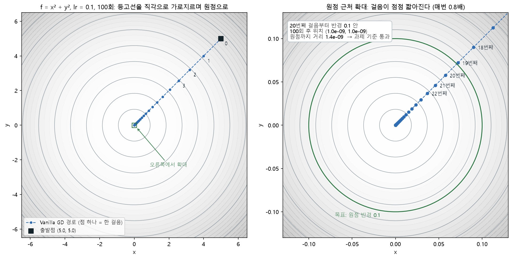 | 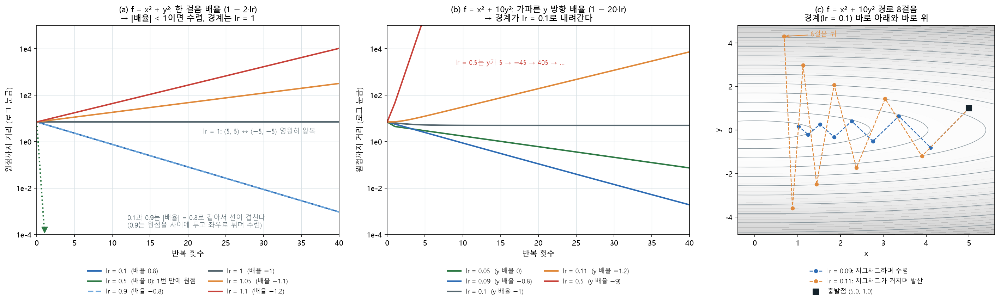 |

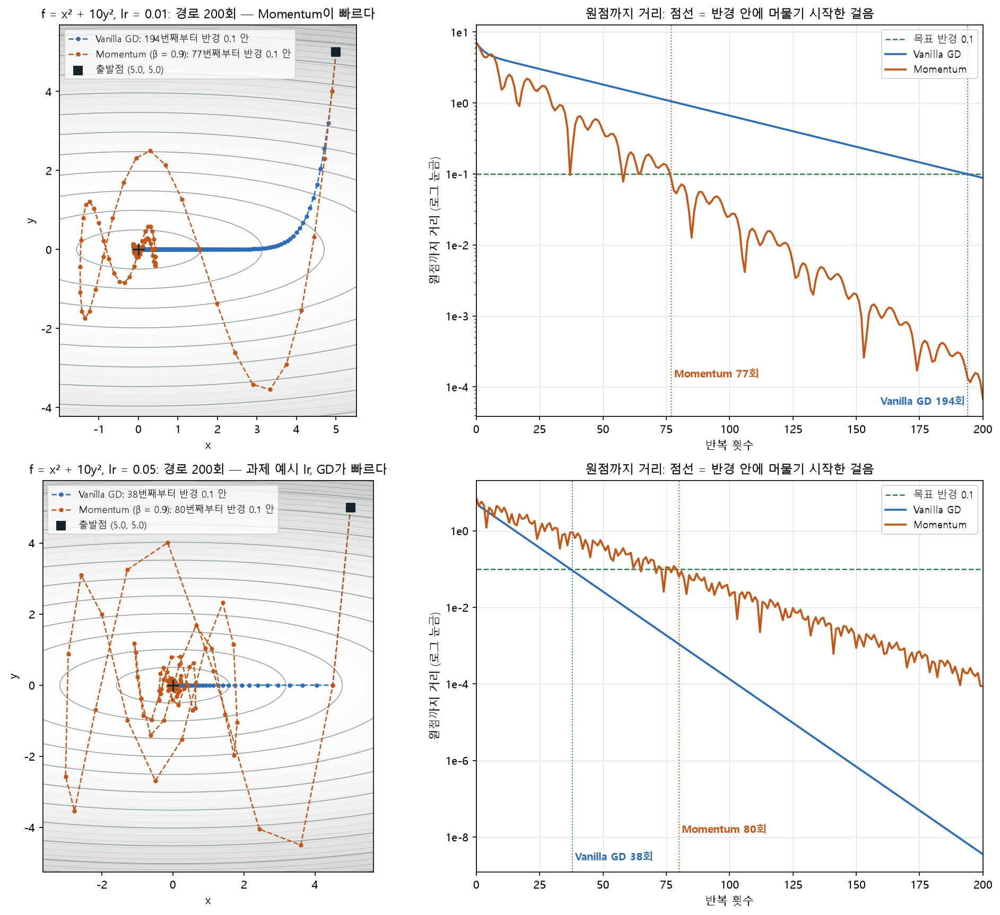

### 3-7. 확률분포와 손실 함수 (`notebooks/probability_loss.ipynb`)

- **정규분포 PDF**: N(0, 1)과 N(2, 0.5)를 한 그림에 비교 (꼭대기 0.3989, 0.5642 = 1/√π, 넓이는 둘 다 1). 표본 1만 개의 히스토그램(seaborn)과 겹쳐 확인했습니다.
- **베르누이 PMF**: B(0.3)과 B(0.7) 막대그래프.
- **softmax**: 최댓값을 빼고 계산해 큰 점수에서도 넘치지 않게 구현. 무작위 1,000세트에서 출력 합과 1.0의 차이 최대 **2.2e-16** (기준 1e-6).
- **MSE = 정규분포 가정의 MLE**: NLL = (n/2)·log(2πσ²) + (n/2σ²)·MSE를 유도하고, 숫자로도 일치(차이 1.7e-13)와 최소 위치 = 표본 평균을 확인.
- **Cross-Entropy = 베르누이/카테고리 가정의 MLE**: 베르누이 NLL / n = BCE, 카테고리분포 NLL = Cross-Entropy를 유도하고, 최소 위치가 각각 앞면 비율·클래스별 비율임을 확인. softmax + Cross-Entropy의 기울기 p − y도 수치 미분과 일치.

| 정규분포 PDF | 베르누이 PMF |
|---|---|
| 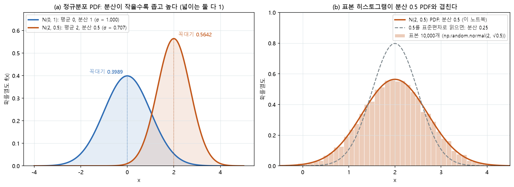 | 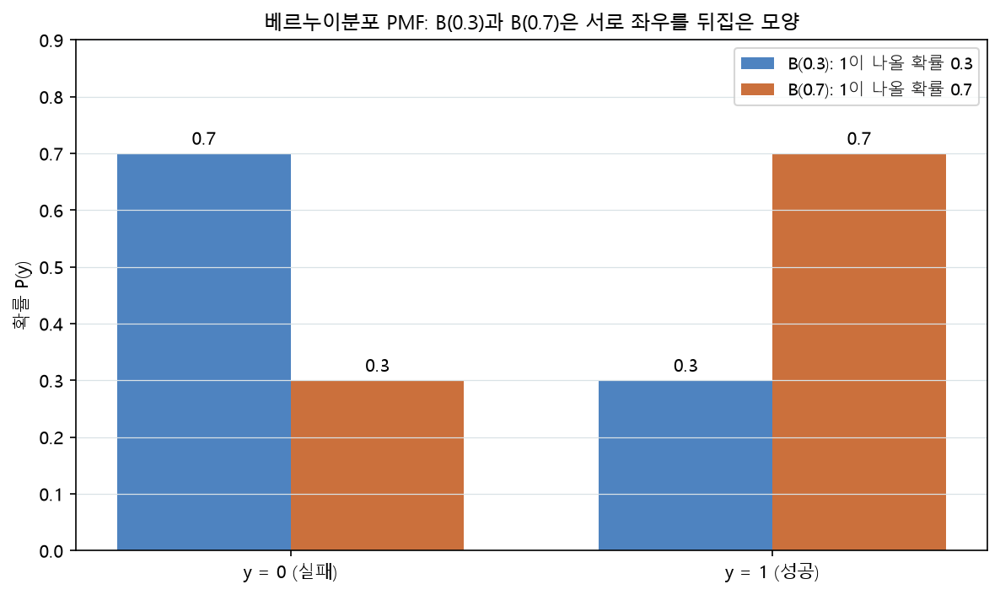 |

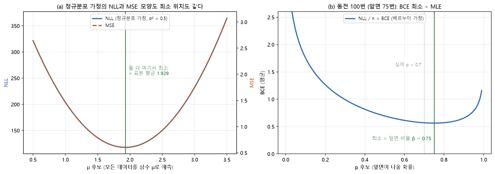

## 4. 과제 예시·안내와 다르게 처리한 곳

과제는 "결과 예시는 정답이 아니라 참고"라고 안내합니다. 직접 계산해 보니 아래는 그대로 따르면 틀린 말이 되는 곳이라, 실험으로 확인하고 정했습니다.

| 항목 | 과제 예시·안내 | 이 레포 | 이유 |
|---|---|---|---|
| SVD 이미지 크기 | 64×64 이하 | **128×128** | 64×64는 성분이 최대 64개라 k = 100 복원을 만들 수 없음 |
| 역전파 정답 y_true | 값이 비어 있음 | **1** | 결과 예시(∂L/∂z2 = −0.3527 = ŷ − 1)가 y = 1로 계산됨 |
| 역전파 z2 | 0.6071 | **0.6072** (0.607155…) | a1을 먼저 4자리로 반올림하고 계산하면 0.6071이 나옴 (노트북 5장에서 재현) |
| 역전파 ∂L/∂z1 두 번째, ∂L/∂W1[1, 0] | −0.0513 | **−0.0517** (−0.051734…) | 어떤 자리수로 반올림해도 −0.0513이 나오지 않아 오기로 판단 |
| 발산하는 학습률 | "lr ≥ 0.5이면 발산" | x² + y²의 경계는 **lr = 1** | 한 걸음 배율 1 − 2·lr. lr = 0.5는 1번 만에 원점. 길쭉한 그릇에서는 0.5가 실제로 발산함을 함께 보임 |
| x² + y²에서 GD vs Momentum | GD (0.08, 0.08), Momentum (0.02, 0.02) → Momentum이 빠름 | GD (1.0e-9, 1.0e-9), Momentum (−0.014, −0.014) → **GD가 빠름** | 둥근 그릇에서는 내리막이 원점을 곧장 향해서 관성이 지나침만 만듦. 둘 다 반경 0.1 기준은 통과 |
| x² + 10y²의 lr = 0.05 | 지그재그와 Momentum의 이점 | lr = 0.05는 y 배율이 0이라 **지그재그가 없고 GD가 빠름** → lr = 0.01을 함께 비교 | lr을 바꿔 가며 어느 쪽이 빠른지 그림으로 정리 (`optimizer_lr_sweep.png`) |
| N(2, 0.5) | 0.5가 분산인지 표준편차인지 없음 | **분산 0.5** (σ ≈ 0.707) | 수학 표기 N(μ, σ²) 관례. `np.random.normal`에는 표준편차 √0.5를 넘김 |
| "도착" 기준 | — | 원점 반경 0.1 안에 **들어가서 계속 머무르기 시작한** 걸음 | Momentum은 관성 때문에 원을 통과해 지나가기도 해서, 처음 들어간 때로 세면 실제보다 빨라 보임 |

## 5. 자동 검증 목록

`python run_all.py` (27개):

| 영역 | 검증 |
|---|---|
| 행렬 변환 (5) | 행렬 5개의 det vs 변환 후 넓이 비율, 오차 1% 이내 |
| Power Iteration (4) | 행렬 4개의 최대 고유값 vs `np.linalg.eig`, 오차 5% 이내 + 고유벡터 방향 |
| SVD (4) | k가 클수록 오차 감소, Eckart–Young 공식과 일치, 전체 성분이면 원본, σ₁ 교차 확인 |
| 미분·Gradient (4) | x²의 x = 3 미분 오차 ≤ 1e-4, 수치 vs 해석적 Gradient, Gradient ⟂ 등고선 (원·타원) |
| 최적화 (7) | GD 100회 반경 0.1 이내, 수치 Gradient 경로 일치, 발산 경계 (원·타원), Momentum 100회 반경 0.1 이내, 타원 lr = 0.01에서 Momentum이 빠름, lr = 0.15에서 GD만 발산 |
| 제출 규칙 (3) | 금지 라이브러리 미사용, 모든 함수·클래스에 Docstring, `np.linalg.eig`는 검증 함수에서만 (코드를 구문 분석해서 확인) |

노트북: 역전파 6개 (손계산 = NumPy 4자리, ∂L/∂z2 = ŷ − y, shape, gradient check, ŷ − y 일반 확인, 한 걸음 학습), 확률 12개 (PDF 넓이, 표본 평균·분산, PMF, softmax 3개, NLL·MSE 2개, BCE 2개, Cross-Entropy, p − y).

난수는 모두 `np.random.seed(42)`로 고정해서 다시 실행해도 같은 숫자가 나옵니다.

## 6. 이미지 출처

SVD 압축에 쓴 사진은 matplotlib에 샘플 데이터로 들어 있는 `grace_hopper.jpg`(그레이스 호퍼 제독의 미 해군 공식 초상, 600×512 컬러)입니다. 미국 연방정부 저작물이라 **퍼블릭 도메인**이고, matplotlib 설치에 포함되어 있어 따로 내려받을 필요가 없습니다. NumPy로 흑백 변환(BT.601 가중치) → 가운데 512×512 자르기 → 4×4 블록 평균으로 128×128로 줄여 사용합니다.

## 7. 과제 요구사항 대응표

| 요구사항 | 어디서 | 결과 |
|---|---|---|
| 단위 원에 회전 R(θ), 스케일링 S(2, 0.5), 전단 Sh(k) 적용, 전후 비교 | `linear_algebra.py`, `transform_*.png` | R(30°), S(2, 0.5), Sh(1) + det ≠ 1 행렬 2개 |
| det(A)와 넓이 비율 비교, 오차 1% 이내 | `run_all.py` | 오차 ≤ 3.2e-14% |
| Power Iteration 최대 고유값, `np.linalg.eig`와 오차 5% 이내 (eig는 검증에서만) | `linear_algebra.py`, `run_all.py` | 행렬 4개, 오차 ≤ 1.6e-7% |
| SVD 압축 k = 10/50/100을 한 Figure에 | `svd_compression.png` | 오차 21.06% / 4.54% / 0.43% |
| f(x) = x², x = 3 수치 미분 오차 1e-4 이내 | `calculus.py` | 오차 3.9e-11 |
| x² + y² 등고선 + Gradient 화살표, 등고선과 수직 | `gradient_field.png` | 18개 점, 90.0000° |
| 2층 신경망 순전파 수식, 연쇄 법칙 역전파 유도, 6개 기울기, shape 표기 | `backprop_derivation.ipynb` 1~2장 | + b1, b2 기울기 |
| 고정 예제 손계산, NumPy와 소수점 4자리 일치 | 같은 노트북 3~4장 | 13개 항목 일치 + gradient check |
| Vanilla GD, x² + y², lr = 0.1, 100회 후 반경 0.1 이내, 경로를 등고선 위 점선으로 | `optimizer.py`, `gd_path.png` | 거리 1.4e-9 |
| lr이 클 때 발산을 그래프로 | `gd_learning_rate.png` | 경계 lr = 1 (타원 0.1) |
| Momentum(β = 0.9), GD와 경로를 한 Figure에 겹쳐 비교 | `optimizer_compare_round.png` | GD 20회, Momentum 77회 |
| x² + 10y²에서 Momentum의 이점 | `optimizer_compare_ellipse.png`, `optimizer_lr_sweep.png` | lr = 0.01: 194회 vs 77회 |
| N(0, 1)과 N(2, 0.5) PDF, B(0.3)과 B(0.7) PMF를 각각 한 Figure에 | `normal_pdf.png`, `bernoulli_pmf.png` | 0.5 = 분산 |
| softmax, 출력 합과 1.0의 차이 1e-6 이내 | `probability_loss.ipynb` 3장 | 최대 2.2e-16 |
| MSE = 정규분포 MLE, Cross-Entropy = 베르누이/카테고리 MLE 유도 | 같은 노트북 5~6장 | 유도 + 숫자 확인 |
| Python 3.8 이상, NumPy ≥ 1.21, Matplotlib ≥ 3.4, `requirements.txt` | `requirements.txt` | Python 3.14.3, NumPy 2.5.5, Matplotlib 3.11.2 |
| `np.random.seed(42)`, 그림은 `outputs/`에 PNG, 모든 함수·클래스에 Docstring, 수식은 주석·Markdown으로 | 전체 | 그림 20장, Docstring은 `run_all.py`가 자동 점검 |
| PyTorch·TensorFlow·JAX·scikit-learn 미사용 | `run_all.py` | 자동 점검 통과 |
